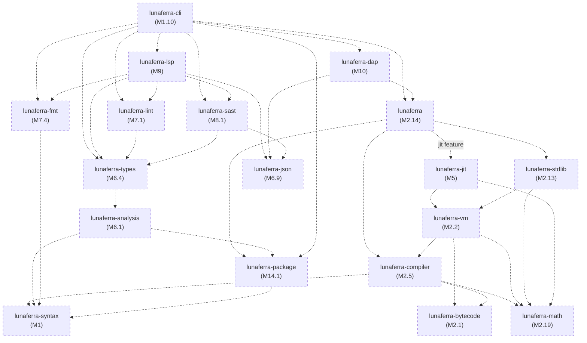

# 01 — Architecture

Lunaferra is a Cargo workspace of small crates in two stacks that share a parser. The runtime stack
turns source into bytecode, runs it, and compiles hot code to machine code. The analysis stack
turns source into a semantic model that the type checker, linter, and SAST tool read. Front ends,
the `lunaferra` command and the editor servers, sit on top. Scripts are organized into packages, as
Cargo organizes Rust code: a manifest names each package and its dependencies, and both stacks
follow the same module graph (ADR-0038, proposed: packages and modules, as Cargo has). The crate map
below names the task that builds each crate.

## Principles

- **Memory safety comes first.** No crate uses `unsafe` except `lunaferra-jit`, and there only in
  the two modules that ADR-0013 (only the JIT's memory and entry modules may use `unsafe`) names.
  A host links `lunaferra-jit` only by turning on the `lunaferra` crate's `jit` feature, which is
  off by default (ADR-0022: the JIT is an optional feature of `lunaferra`, off by default). The heap
  is safe Rust (ADR-0011: values live in arenas and are reached through checked handles).
- **The interpreter is the reference.** Every tier of the JIT must produce what the interpreter
  produces. When generated code meets a case it didn't plan for, it exits to the interpreter at the
  same instruction (ADR-0012).
- **Errors are values, never panics.** A Lua error travels through Rust as an `Err` and unwinds Lua
  frames one by one. A panic is always a bug, and no input may cause one.
- **Every limit is enforced inside the VM.** Memory, instruction, and depth limits hold inside
  library calls too, so a host never depends on a script's cooperation (ADR-0014).
- **One parser feeds everything.** The compiler and the tools read the same parse, so they agree
  on every program (ADR-0009).
- **No third-party code** (ADR-0002). Lunaferra writes what it needs, in a crate of its own, with
  tests.

## Crate map

Each crate lives in `crates/<name>/`, except the fuzzer in `fuzz/` and the build tasks in `xtask/`.
Commits use the name without the `lunaferra-` prefix as their scope, as `.claude/rules/commits.md`
describes; the `lunaferra` crate's scope is `lunaferra`.

| Crate | Job | Depends on | crates.io | Spec | Lands in |
| :- | :- | :- | :- | :- | :- |
| `lunaferra-syntax` | Lexer, parser, syntax trees, spans, and the shared diagnostic type | — | Yes | [syntax](specs/syntax.md) | M1 |
| `lunaferra-bytecode` | Instruction set, function prototypes, chunk format, and verifier | — | Yes | [bytecode](specs/bytecode.md) | M2.1 |
| `lunaferra-math` | Floating-point functions with the same bits on every target (ADR-0027) | — | Yes | [math](specs/math.md) | M2.19 |
| `lunaferra-compiler` | Compact tree to bytecode: scopes, registers, strict mode | syntax, bytecode, math | Yes | [compiler](specs/compiler.md) | M2.5 |
| `lunaferra-vm` | Heap and loop collector, values, tables, interpreter, metamethods, coroutines, limits, debug hooks | bytecode, compiler, math | Yes | [vm](specs/vm.md) | M2.2 |
| `lunaferra-jit` | x86-64 and AArch64 encoders, executable memory, baseline and optimizing tiers | vm, bytecode, math | Yes | [jit](specs/jit.md) | M5 |
| `lunaferra-stdlib` | The standard libraries, Lua 5.5's with positions from 0 | vm, math | Yes | [stdlib](specs/stdlib.md) | M2.13 |
| `lunaferra` | The embedding API that hosts depend on | vm, compiler, stdlib; jit with its `jit` feature | Yes | [lunaferra](specs/lunaferra.md) | M2.14 |
| `lunaferra-analysis` | Semantic model: scopes, symbols, control flow, data flow, modules | syntax | Yes | [analysis](specs/analysis.md) | M6.1 |
| `lunaferra-types` | Gradual type checker | analysis, syntax | Yes | [types](specs/types.md) | M6.4 |
| `lunaferra-lint` | Lint rules | analysis, types | Yes | [lint](specs/lint.md) | M7.1 |
| `lunaferra-fmt` | Formatter | syntax | Yes | [fmt](specs/fmt.md) | M7.4 |
| `lunaferra-sast` | Taint analysis and security rules, with SARIF output | analysis, types, json | Yes | [sast](specs/sast.md) | M8.1 |
| `lunaferra-json` | JSON values, parser, writer, and protocol message framing | — | Yes | [json](specs/json.md) | M6.9 |
| `lunaferra-package` | Package manifests, lock files, versions, the dependency resolver, and the module graph (ADR-0038, ADR-0039) | syntax | Yes | [package](specs/package.md) | M14.1 |
| `lunaferra-lsp` | Language server | json, analysis, types, lint, fmt, sast | Yes | [lsp](specs/lsp.md) | M9 |
| `lunaferra-dap` | Debug adapter | json, lunaferra | Yes | [dap](specs/dap.md) | M10 |
| `lunaferra-cli` | The `lunaferra` command, including fetching packages with Git | all of the above | Yes | [cli](specs/cli.md) | M1.10 |
| `lunaferra-testkit` | Seeded random generator, property tests, Lua source generator | — | No: a dev-dependency only | [04-quality](04-quality.md#the-projects-own-test-tools) | M0.2 |
| `lunaferra-fuzz` | The fuzzer and its targets, in `fuzz/` | testkit, the crates it targets | No | [04-quality](04-quality.md#the-projects-own-test-tools) | M0.4 |
| `lunaferra-webtest` | The WebAssembly test module the browser harness runs, in `xtask/webtest/` | lunaferra | No | [04-quality](04-quality.md#the-projects-own-test-tools) | M3.17 |
| `xtask` | `cargo xtask coverage`, `fuzz`, `record`, `test`, and `bench` | — | No | [04-quality](04-quality.md#the-projects-own-test-tools) | M0.3 |

Four specs cover contracts that span crates: [`language.md`](specs/language.md) (Lunaferra's
language), [`memory.md`](specs/memory.md) (reference counting and the heap),
[`sandbox.md`](specs/sandbox.md) (libraries and limits), and
[`diagnostics.md`](specs/diagnostics.md) (codes, output formats, and configuration).

## Layers

A crate may depend only on crates in lower layers, or on lower crates in its own stack:

| Layer | Runtime stack | Analysis stack |
| :- | :- | :- |
| 3. Front ends | `lunaferra-cli`, `lunaferra-dap` | `lunaferra-cli`, `lunaferra-lsp` |
| 2. Services | `lunaferra` (embedding API) | `lunaferra-lint`, `lunaferra-sast`, `lunaferra-fmt` |
| 1. Engines | `lunaferra-compiler`, `lunaferra-vm`, `lunaferra-stdlib`, `lunaferra-jit` | `lunaferra-analysis`, `lunaferra-types` |
| 0. Foundations | `lunaferra-syntax`, `lunaferra-package`, `lunaferra-bytecode`, `lunaferra-json` | `lunaferra-syntax`, `lunaferra-package`, `lunaferra-json` |

- The runtime stack never depends on the analysis stack, so a host that embeds Lunaferra doesn't
  build the type checker. The compiler reads type annotations from the syntax tree and stores them
  as hints in the bytecode; the JIT reads the hints, never the type checker (ADR-0006).
- `lunaferra-vm` doesn't depend on `lunaferra-jit`. The VM defines a trait for a compiled tier, and
  the `lunaferra` crate plugs the JIT into it when its `jit` feature is on, so the VM, and a host
  that leaves the feature off, build and run without machine code.
- `lunaferra-vm` and `lunaferra-stdlib` don't depend on `lunaferra-package`. The standard library's
  `require` asks a resolver trait it defines, and the `lunaferra` crate implements it with the
  module graph ([`specs/package.md`](specs/package.md#how-a-state-uses-the-graph)).
- Nothing depends on a front end.

The diagram shows what depends on what. Every part is drawn dashed because none is built yet; a
part is redrawn solid in the change that builds it.



## Source layout

```text
Cargo.toml            the workspace: members, [workspace.package], [workspace.lints]
Cargo.lock
rust-toolchain.toml   Rust 1.100.0 with Clippy, rustfmt, and llvm-tools
clippy.toml
.cargo/config.toml    the `cargo xtask` alias
crates/<name>/        one folder per crate in the crate map
fuzz/                 lunaferra-fuzz, with corpus/ and regressions/
xtask/                coverage, conformance recording, test runners, and benchmarks
  webtest/            lunaferra-webtest, and the page the browser harness opens
tests/conformance/    Lunaferra scripts for behavior kept from Lua 5.5
  reference/          their Lua 5.5 twins, each with the .out file PUC-Rio Lua 5.5.1 printed
tests/extensions/     scripts for Lunaferra's own behavior, with .out files written from the specs
benches/lua/          Lunaferra benchmark scripts, with their Lua 5.5 twins in reference/
docs/                 these documents
```

## Running a script

1. The host creates a state with `lunaferra::Lua::new`, choosing its libraries, limits, and, with
   the `jit` feature, its JIT mode ([`specs/lunaferra.md`](specs/lunaferra.md)).
2. `Lua::load` passes the source to `lunaferra-syntax`, whose parser builds the compact tree. A
   syntax error returns a message in PUC-Rio's format, such as
   `input:3: unexpected symbol near 'end'`.
3. `lunaferra-compiler` resolves names under the scoping rules of
   [`specs/language.md`](specs/language.md#scoping-adr-0025), applies strict mode where it is on
   (ADR-0008), allocates registers, and emits a function prototype in `lunaferra-bytecode`'s format.
4. `lunaferra-vm` runs the prototype in its interpreter. Each value is reference counted
   ([`specs/memory.md`](specs/memory.md)); when a count reaches zero, the value is freed, and a
   `__gc` finalizer, if it has one, runs at the next safe point. Values that only reference
   loops keep alive are freed by the loop collector, which runs at a safe point when the bytes
   allocated pass the host's threshold, or when the script or host asks (ADR-0018: a
   deterministic loop collector on top of reference counting).
5. The interpreter counts calls and loop iterations. With the `jit` feature on, when a function
   gets hot, the JIT compiles it, and later calls run the machine code. A failed guard exits to the
   interpreter at the same instruction ([`specs/jit.md`](specs/jit.md)).
6. A Lua error returns `Err` through each frame until a `pcall` catches it or it reaches the host.
   A limit error passes through `pcall` to the host ([`specs/sandbox.md`](specs/sandbox.md)).
7. Dropping the state runs the pending finalizers, then frees every value left.

## Building a project from packages

1. `lunaferra fetch`, or any command that runs or checks a package, reads the manifest,
   `Lunaferra.lua`, of the package or workspace it runs in, with `lunaferra-package`, which parses
   it and never runs it (ADR-0016: a data-only Lua file).
2. The resolver picks a version of each dependency that meets every requirement, trying the
   versions in `Lunaferra.lock` first, and writes the lock file again only if a choice changed
   (ADR-0039, proposed: dependencies from paths and Git, pinned in a lock file).
3. `lunaferra-cli` fetches each Git dependency's locked commit into the per-user cache by running
   `git`, and writes only the commit's regular files
   ([`specs/package.md`](specs/package.md#fetching-with-git)).
4. `lunaferra run` creates a state, installs the packages with `Lua::add_packages`, and runs the
   package's `src/main.lua`. Each `require` resolves in the namespaces of the package that holds
   the calling function, and each module loads once per state.

## Checking a script

1. `lunaferra check`, `lint`, or `sast`, or the language server, reads the `tools` table of the
   nearest manifest, `Lunaferra.lua` (ADR-0016; ADR-0038), and the files it names.
2. `lunaferra-syntax` builds a lossless tree for each file, with errors marked in place, so a file
   that doesn't parse still gets checked.
3. `lunaferra-analysis` resolves names, builds each function's control flow graph, and links the
   files through `require` calls with literal names, following the module graph in a package.
4. `lunaferra-types` infers and checks types; `lunaferra-lint` and `lunaferra-sast` run their rules
   on the typed model.
5. Every tool reports the same diagnostic type, which the command line prints as text, JSON, or
   SARIF, and the language server sends to the editor
   ([`specs/diagnostics.md`](specs/diagnostics.md)).

## Threads

No crate starts a thread or an async runtime. A Lua state is used from one thread at a time, and
its coroutines run on the thread that resumes them. A host that needs scripts in parallel creates
one state per thread; states share nothing. Whether a state can move between threads, that is,
whether `Lua` implements `Send`, is settled in M3.1. The debug server in a host (M10.4) waits for
messages inside the VM's debug hook instead of on a thread of its own.

## Configuration

| What | Where | Who sets it |
| :- | :- | :- |
| Libraries, limits, JIT mode, and strict-mode defaults for a state | `lunaferra::Options` | The host |
| Chunk name, text or binary mode, and strict mode for one chunk | `lunaferra::ChunkOptions` | The host |
| Strict mode for one file | A first line of `--!strict` (ADR-0008) | The script's author |
| A package's name, version, exports, and dependencies | `Lunaferra.lua` (ADR-0038) | The package's author |
| The exact version and commit of every dependency | `Lunaferra.lock` (ADR-0039), committed with the project | `lunaferra fetch` and `lunaferra update` |
| Tool settings: paths, rules, format style, taint sources and sinks | The `tools` table of `Lunaferra.lua` (ADR-0016, ADR-0038) | The project |
| Where fetched packages are kept | `LUNAFERRA_HOME`, or `.lunaferra` in the home folder | The user |
| One run of a tool | Command-line flags, which override the manifest | The user |

Library crates read no environment variables and no files of their own accord. Only `lunaferra-cli`
reads them, as [`specs/cli.md`](specs/cli.md) lists, and only it starts another program: `git`,
to fetch packages.
